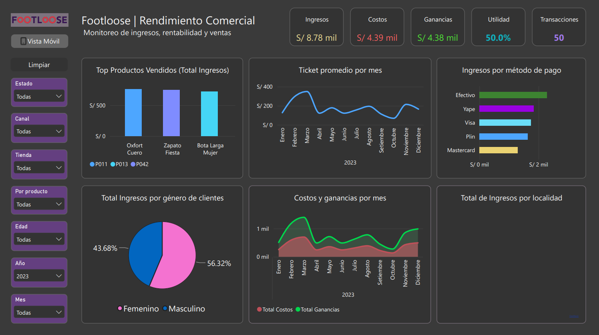
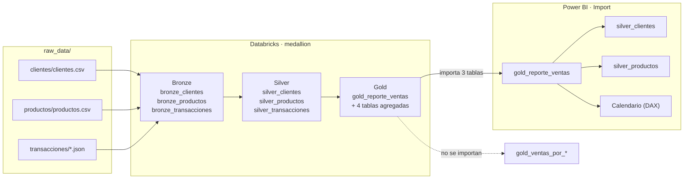
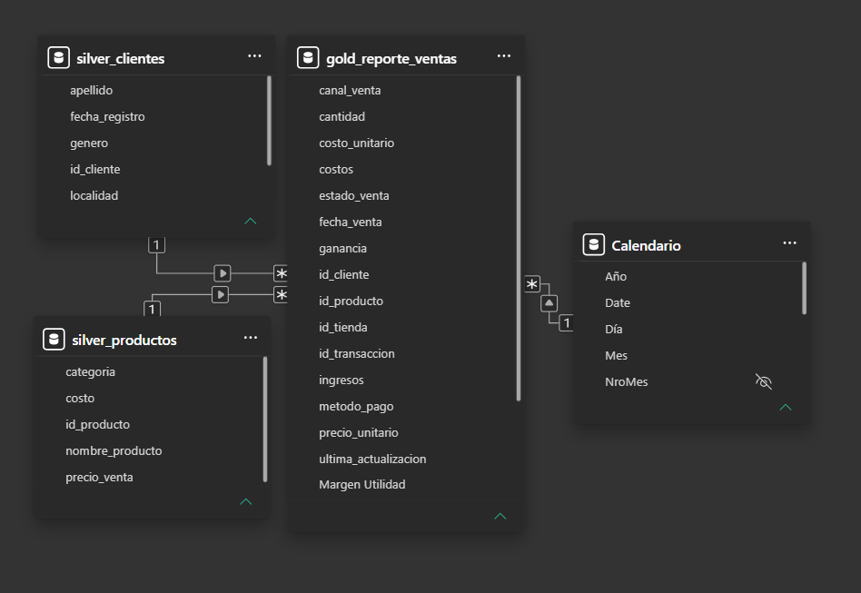

# 👟 Footloose · Dashboard de Ventas en Power BI

Dashboard analítico de ventas para una cadena de calzado con operación en tiendas físicas y canal web, construido sobre un modelo estrella en Power BI alimentado desde Databricks con arquitectura medallion.




---

## 📌 Resumen

| Indicador | Valor |
|---|---|
| Ingresos totales | **S/ 24,537.60** |
| Costos totales | S/ 12,278.00 |
| Ganancia bruta | **S/ 12,259.60** |
| Margen de utilidad | **49.96 %** |
| Transacciones | 150 |
| Ticket promedio | S/ 163.58 |
| Período analizado | ene 2023 – dic 2025 |

---

## 🎯 Contexto del caso

Footloose vende calzado en tres tiendas físicas (T01, T02, T03) y una tienda online (WEB), con clientes distribuidos en seis ciudades del Perú. La gerencia necesitaba responder preguntas que el reporte transaccional no resolvía:

- ¿Qué categorías y productos sostienen realmente el margen?
- ¿El canal web es rentable o solo volumen?
- ¿Dónde está el cliente que más aporta: ciudad, género, edad?
- ¿Cuánto ingreso se pierde en ventas canceladas o pendientes?

El dashboard responde a estas preguntas en una sola pantalla, con filtros cruzados por año, categoría, canal, estado, tienda y rango de edad.

> Los datos corresponden a un dataset de práctica (150 transacciones) con la estructura de un caso real de retail: tablas normalizadas, catálogos de clientes y productos, y un pipeline medallion en Databricks.

---

## 🏗️ Arquitectura de datos



| Capa | Contenido |
|---|---|
| **Bronze** | Datos crudos ingeridos desde `raw_data/` con Auto Loader + checkpoint (`bronze_clientes`, `bronze_productos`, `bronze_transacciones`) |
| **Silver** | Catálogos limpios y transacciones validadas: `silver_clientes` (30 filas, 7 columnas), `silver_productos` (50 filas, 5 columnas), `silver_transacciones` (150 filas) |
| **Gold** | Tabla de hechos desnormalizada para consumo: `gold_reporte_ventas` (150 filas, 15 columnas) + **4 tablas agregadas** por `metodo_pago`, `canal_venta`, `estado_venta` y top productos |
| **Power BI** | Conexión vía conector `DatabricksMultiCloud` en **modo importación** (archivo de 370 KB). Importa **3 tablas**: `gold_reporte_ventas`, `silver_clientes` y `silver_productos` |

La tabla de hechos ya trae los importes calculados (`ingresos`, `costos`, `ganancia`, `precio_unitario`, `costo_unitario`), de modo que el modelo es liviano y las medidas son agregaciones simples y rápidas.

> El detalle técnico del pipeline (esquemas, checkpoints y cómo ejecutarlo) está en [`databricks/README.md`](databricks/README.md).

---

## 🧩 Modelo de datos



Esquema estrella con una tabla de hechos al centro y tres dimensiones, todas las relaciones **muchos a uno (M:1), activas y con filtro en una sola dirección**:

| Desde | Hacia | Cardinalidad |
|---|---|---|
| `gold_reporte_ventas[id_producto]` | `silver_productos[id_producto]` | M:1 |
| `gold_reporte_ventas[id_cliente]` | `silver_clientes[id_cliente]` | M:1 |
| `gold_reporte_ventas[fecha_venta]` | `Calendario[Date]` | M:1 |

`Calendario` es una **tabla calculada en DAX** con 1,096 días, columnas de año, mes, trimestre y una jerarquía de fechas propia. Al ser una tabla de fechas dedicada y no una columna de fecha en la tabla de hechos, la inteligencia temporal funciona de forma consistente en todos los visuales.

**Decisiones de modelado**

- Relaciones en una sola dirección: evita ambigüedades y el costo de filtros bidireccionales.
- Dimensiones conformadas reutilizables: el mismo `silver_clientes` sirve para todos los cortes.
- Sin duplicados en `id_transaccion` y sin valores nulos en las tres tablas.
- Medidas explícitas en lugar de agregaciones implícitas, para controlar formato y nombres.

---

## 🧮 Medidas DAX

| Medida | Fórmula | Uso |
|---|---|---|
| `Total Ingresos` | `SUM(gold_reporte_ventas[ingresos])` | KPI principal |
| `Total Costos` | `SUM(gold_reporte_ventas[costos])` | Costo de ventas |
| `Total Ganancias` | `SUM(gold_reporte_ventas[ganancia])` | Utilidad bruta |
| `Promedio Ingresos` | `AVERAGE(gold_reporte_ventas[ingresos])` | Ingreso medio por transacción |
| `Margen Utilidad` | `DIVIDE([Total Ganancias], [Total Ingresos], 0)` | Rentabilidad sobre ventas |
| `N.Transacciones` | `COUNT(gold_reporte_ventas[id_transaccion])` | Volumen operativo |

`DIVIDE` se usa en lugar del operador `/` para que el margen devuelva **0** (y no un error) cuando no hay ventas en el contexto de filtro.

---

## 📊 El dashboard

Dos páginas: **Dashboard** (1280 × 720) y **Vista Móvil** (720 × 2700), ambas con tema oscuro personalizado sobre la base Fluent2.

**Visuales principales**

- Tarjetas KPI: Ingresos, Costos, Ganancias, Utilidad y Transacciones.
- Mapa de burbujas: ingresos por localidad.
- Barras: ingresos por método de pago.
- Circular: participación por género de cliente.
- Columnas: top de productos vendidos.
- Área apilada: costos y ganancias por mes.
- Líneas: ticket promedio por mes.

**Interactividad**

- Segmentadores de año, categoría, canal, estado, tienda y rango de edad.
- Botón **Limpiar filtros** que restablece todos los segmentadores de una vez.
- Filtrado cruzado entre visuales y orden de tabulación configurado para navegación con teclado.

---

## 🔍 Hallazgos

1. **El margen es alto y estable en 49.96 %.** Los costos representan casi exactamente la mitad de los ingresos, lo que deja poco espacio para descuentos agresivos sin comprometer la rentabilidad.
2. **El negocio depende del segmento de 25 a 34 años: 82.2 % de los ingresos** (120 de 150 transacciones). Es un riesgo de concentración: la estrategia comercial está calibrada para un solo grupo etario.
3. **El canal web aporta 35.6 % de los ingresos pero tiene el ticket más bajo**: S/ 145.6 contra S/ 175.6 en tienda física. Crece en volumen, no en valor por pedido.
4. **Piura y Trujillo concentran 49.8 % de la facturación** (S/ 6,841.1 y S/ 5,381.7). Lima, siendo la plaza más grande del país, solo aporta 16.7 %.
5. **Tres categorías explican 75.6 % del ingreso**: Zapatillas (32.7 %), Zapatos (22.8 %) y Botas (20.1 %). Chinelos y Alpargatas juntas no llegan al 3 %.
6. **21.8 % del ingreso registrado está en ventas no completadas**: 10.9 % canceladas y 10.9 % pendientes (S/ 2,674 cada grupo). Recuperar la mitad de ese monto equivaldría a unos S/ 2,674 adicionales.
7. **Yape es el método de pago líder con 22.3 %**, por encima de efectivo (21.5 %), Visa (20.3 %), Mastercard (19.0 %) y Plin (16.9 %). Es un dato relevante para decisiones de cobranza e integración de pasarelas.

---

## 🛠️ Decisiones técnicas destacadas

- **Modo importación** en lugar de DirectQuery: el volumen es pequeño y así los visuales responden sin latencia.
- **Tabla de fechas calculada** en DAX, independiente del origen, para desacoplar la inteligencia temporal del pipeline.
- **Desnormalización deliberada en gold**: los importes se materializan en la tabla de hechos, evitando cálculos costosos en tiempo de consulta.
- **Vista móvil diseñada aparte**, no como reescalado de la vista de escritorio.
- **Tema visual propio** (`ReportThemeDark`) aplicado sobre Fluent2, con paleta consistente entre páginas.
- **Escritura idempotente en Silver y Gold**: `MERGE` por clave de negocio con `foreachBatch`, para que los reintentos no dupliquen filas.
- **Edad con fecha de corte fija** (`2025-12-31`): el segmento etario es reproducible y coherente con el período analizado (2023-2025).

---

## 🧠 Habilidades demostradas

**Power BI**
- Modelado dimensional (esquema estrella), relaciones M:1 y tabla de fechas dedicada.
- DAX: medidas explícitas, `DIVIDE` con manejo de ceros, formatos y nombres controlados.
- Diseño de reportes: tema oscuro, vista móvil independiente, botones de acción y navegación por teclado.

**Databricks / PySpark**
- Arquitectura medallion (bronze → silver → gold) con separación de capas.
- Spark Structured Streaming + Auto Loader + checkpoints para ingesta incremental.
- Delta Lake: tipado, deduplicación, joins, agregaciones y **upserts idempotentes con `MERGE`**.
- Diseño de pipelines **ELT** y documentación reproducible.

---

## 🚧 Limitaciones y próximos pasos

- **Datos sintéticos**: el dataset es de práctica y no representa una empresa real.
- **Orquestación**: el notebook se ejecuta manualmente; el siguiente paso es empaquetarlo como Databricks Workflow o Asset Bundle.
- **Calidad de datos**: no hay tests automatizados ni tabla de cuarentena; se podría sumar `pytest` + `chispa` o expectativas de DLT.
- **Seguridad**: no hay RLS ni gobierno de PII en bronze.
- **Escalabilidad**: el modelo es pequeño (150 filas); no se probó con volúmenes grandes.

---

## ▶️ Cómo abrirlo

> **Ver en línea:** [Dashboard interactivo en Power BI](https://app.powerbi.com/view?r=eyJrIjoiYjliZjc4ODYtNWQ4Ni00OTFiLTk2MTQtZTE4MGRhYTZiNTUzIiwidCI6ImM0YTY2YzM0LTJiYjctNDUxZi04YmUxLWIyYzI2YTQzMDE1OCIsImMiOjR9)

1. Descarga `powerbi/footloose-sales-dashboard.pbix`.
2. Ábrelo con **Power BI Desktop** (versión de noviembre de 2025 o superior, por el esquema de definición 2.14).
3. Los datos están **incluidos en el archivo**: se visualiza todo sin credenciales.
4. Para **actualizar** desde el origen sí se requiere acceso al workspace de Databricks (
   `footloose_bronce` → `footloose_silver` → `footloose_gold`).

> **Vista previa rápida (sin Power BI):** [`powerbi/exports/footloose-sales-dashboard.pdf`](powerbi/exports/footloose-sales-dashboard.pdf).

---

## 📁 Estructura del repositorio

```
.
├── powerbi/
│   ├── footloose-sales-dashboard.pbix   # fuente editable
│   └── exports/                         # artefactos generados
│       ├── dashboard.png                # Vista general del dashboard
│       ├── modelo-datos.png             # Diagrama del esquema estrella
│       └── footloose-sales-dashboard.pdf  # Vista previa exportada
├── raw_data/                        # datos sintéticos para reproducir el pipeline
│   ├── clientes/
│   │   └── clientes.csv
│   ├── productos/
│   │   └── productos.csv
│   └── transacciones/
│       ├── transacciones_2023.json
│       ├── transacciones_2024.json
│       └── transacciones_2025.json
├── databricks/
│   ├── notebook-databricks.ipynb
│   └── README.md
├── LICENSE
├── .gitignore
└── README.md
```

---

## 📂 Origen de los datos

| Elemento | Valor |
|---|---|
| **raw_data/** | Datos sintéticos para pruebas incluidos en el repo: 150 transacciones, 30 clientes, 50 productos (≈53 KB en total), organizados en `clientes/`, `productos/` y `transacciones/`. Se suben para que el pipeline sea reproducible: quien clona el repo tiene los inputs del ELT y puede ejecutar el notebook para regenerar las tablas Gold. |
| **databricks/** | Pipeline **ELT** medallion en 4 secciones (1. Setup, 2. 01_bronce, 3. 02_silver, 4. 03_gold). Notebook exportado sin salidas + README de la carpeta. |
| **powerbi/footloose-sales-dashboard.pbix** | Modelo importado con 3 tablas (`gold_reporte_ventas`, `silver_clientes`, `silver_productos`) + `Calendario` calculado en DAX; no requiere credenciales para visualizar. Para actualizar se necesita acceso al workspace de Databricks (bronce → silver → gold). |

> Los datos de este proyecto son **simulados para práctica** y no contienen información real de ninguna empresa.

---


